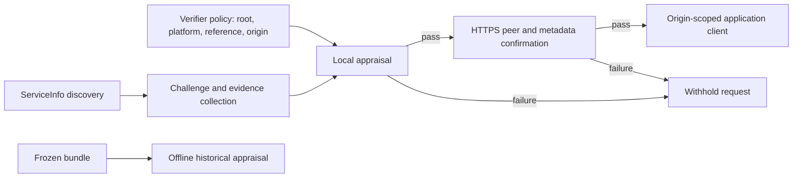

# Confido

Confido verifies remote execution-environment evidence and compares measured state with a verifier-approved reference. The **0.3.0** API returns a structured appraisal result and exposes an origin-scoped HTTPS client only after live appraisal and HTTPS peer authentication succeed.

The implemented profile is **`azure-snp-vtpm-ima/1`**: Milan/VCEK-backed AMD SEV-SNP evidence, Azure HCL metadata, a fresh vTPM quote, signed PCR selection, boot aggregate and enrolled IMA state. It supports an intentionally incompatible reference through the same appraisal path.



## Assurance boundary

The chain is AMD ARK → ASK → VCEK → SNP report → HCL variable data → vTPM attestation key → signed quote. The quote binds a fresh nonce, the TLS certificate and an IMA-log digest. Its signed PCR selection and digest authenticate the bundled PCR values.

The initial enrolled log covers a boot aggregate and kernel modules. It does not measure application code, configuration, models or GPU state. The chat example's Azure-hosted inference is outside the appraised VM. The enrolled TCB floor and launch measurement are operator decisions, not declarations that all platform vulnerabilities are remediated. Automated revocation/security-advisory checks remain a limitation.

**TLS session binding is unsupported.** Certificate-bound evidence does not establish relay resistance. The fresh object is the quote; the SNP report need not be regenerated. Guest collector behavior, TLS key custody and the interval after appraisal remain assumptions. Admission is a cooperating client's point-in-time decision, not server-side capability enforcement. See the [profile decision](docs/revision/decisions/001-bounded-profile.md) and [claim/coverage matrix](docs/revision/coverage.md).

## Build

Frozen target: Linux x86_64, Rust **1.98.0**, CPython **3.10**. Cargo locks are tracked. Python is optional for Rust users; the wheel enables the `python` feature. No WASM interface is supported.

```sh
sudo apt-get install build-essential pkg-config perl libssl-dev clang libclang-dev libtss2-dev python3-dev python3-venv
cargo test --locked --manifest-path lib/Cargo.toml
cargo test --locked --manifest-path server/Cargo.toml
cargo build --locked --manifest-path server/Cargo.toml
cargo build --locked --manifest-path client/Cargo.toml
```

`az-snp-vtpm` is pinned to the original [Kinvolk/Microsoft repository](https://github.com/kinvolk/azure-cvm-tooling) at `9c6bff6c959994da280f8b3b5bad62a1600063d0`. Multi-bank support is retained with attribution in `lib/src/vtpm.rs`. See [third-party notices](THIRD_PARTY_NOTICES.md).

### Python wheel

```sh
python3 -m venv .venv
. .venv/bin/activate
python -m pip install 'maturin==1.15.0' 'patchelf==0.17.2.4'
make -C lib install PYTHON=python
python -m unittest discover -s lib/tests -v
```

This builds the local wheel; it requires no publication. The sibling `confidential-ai-example` builds its container from that exact wheel and hashed Python requirements.

## API and replay

```python
import json
import confido

policy = open("profiles/match.json").read()  # operator-reviewed, never from discovery
preview = confido.discover_py(policy)       # public bootstrap metadata only
print(preview)
# Obtain application-level consent before collecting evidence.
session = confido.connect_py(policy, preview, "/private/new-run.json")
result = json.loads(session.result_json)
if result["application_admitted"]:
    status, headers, body = session.request("GET", result["origin"] + "/service-info", [], b"")
```

The session has no public constructor. It owns a private HTTPS client, keeps normal hostname validation, trusts only the appraised leaf certificate, and rejects redirects, HTTP downgrade, caller-supplied authority headers and another origin. The Python chat client wraps it as an HTTPX transport.

`appraisal::AppraisalConfig`, `EvidenceBundle`, `AppraisalResult`, `connect` and `appraise` provide the equivalent Rust API. Statuses distinguish `invalid_evidence`, `policy_mismatch`, `unsupported_profile` and `dependency_unavailable`. The result carries stages/reasons, fingerprints, challenge, reference identity, coverage, bindings, timings and limitations. Result schema version is 1. The result is not a signed assertion for third parties.

```sh
client/target/debug/confido_client appraise profiles/match.json /private/new-run.json
client/target/debug/confido_client replay profiles/match.json /private/new-run.json EVALUATION_UNIX_TIME
```

Replay evaluates a frozen bundle at an independently chosen time. It never authorizes a fresh request. Bundles contain public endorsements and potentially sensitive host measurements; keep them private and inspect before sharing. Python runs save a `.result.json` and full `.attestation.log` alongside the bundle, with mode 0600. No application credentials or prompts are stored.

### Compatibility

`aTLS_connect`, `aTLS_connect_with_registry`, `aTLS_connect_py` and `ATLS` remain **legacy compatibility APIs**. They use mutable DNS/IP-based reference selection and the earlier checks. They do not implement the complete 0.3.0 policy or scoped-admission API; do not use them for new integrations. Existing binding transcript v1 is preserved; a domain-separated successor requires a new version and shared vectors.

## Public contract and deployment

- `GET /service-info`: GA4GH metadata plus a custom `teeReport` advertisement.
- `POST /tee-report`: JSON `nonce`, standard base64 of exactly 32 bytes. Response: `profile`, `wireVersion: 1`, `evidence`, PEM `certificate` bytes; `Cache-Control: no-store`.
- `/v1/...`: application traffic after client admission.

All public routes use HTTPS 443. HTTP 80 redirects with 308; `/aTLS` remains 404. The new client requires the versioned advertisement and fails closed on older sidecars. The TEE resource path is a Confido convention, not a GA4GH-standard TEE endpoint.

The collector has one concurrent TPM operation, three bounded snapshot attempts and a 20-second response deadline. A timed-out blocking TPM operation retains its permit until it finishes. KDS lookups have bounded body size, three attempts and a 60-second total deadline, including cache-lock wait. No GPU collection runs on the required path.

Use the aligned [deployment templates](server/deployment/README.md), [preflight](scripts/preflight.py), [isolated acceptance harness](scripts/stage_demo.py) and [rerun checklist](docs/revision/rerun.md). Public services are promoted separately after reviewing the staged results.

## Revision artifacts

- [Baseline/deployment manifest](docs/revision/checkpoint.json)
- [Implementation brief](docs/revision/prompt.md) and [review](docs/revision/review.md)
- [API/reference decision](docs/revision/decisions/002-api-and-references.md)
- [Wire/deployment decision](docs/revision/decisions/003-contract-and-build.md)
- [Technical walkthrough](docs/revision/walkthrough.md) and [roadmap](docs/revision/roadmap.md)

## Licence status

Confido's repository licence and the existing proprietary RPM labels require an owner decision before an open release. This revision neither assigns a new licence nor claims a published open release. Upstream licences and notices remain applicable; see `THIRD_PARTY_NOTICES.md`.
