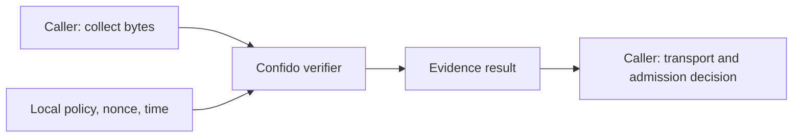

# Confido 0.2

Development revision in JAN DIGITRUST; a 0.2.0 release has not been published.

Confido is a portable **evidence verifier**. It accepts bytes, locally selected
policy, an independent expected nonce and explicit evaluation time. It returns an
`evidence_only` result. It opens no connection and creates no application session.

The supported profile is `azure-snp-vtpm-ima/1`: pinned AMD Milan or Genoa ARK → ASK → VCEK
→ SNP report → Azure HCL → vTPM AK → quote → PCR/IMA/reference checks. Wire v1 and
its existing certificate/IMA transcript are preserved.



## Packages

| Directory | Responsibility |
|---|---|
| [`protocol/`](protocol/README.md) | Wire v1 structures and binding transcript |
| `lib/` | Portable synchronous verifier, bounded binary parsers |
| `bindings/python/` | `confido-verifier` distribution / `confido_verifier` import |
| `bindings/wasm/` | Same verifier compiled to WASM |
| `server/` | Native TPM/IMA collector and `/tee-report` HTTP endpoint |
| `client/` | HTTP collection, explicit verification and historical replay |
| `extension/` | Local WASM worker, policy import, archive replay, permitted live retrieval |

The chat application's native TLS transport lives in the sibling
`confidential-ai-example/native_transport`, independently of this library.
The collector accepts a fresh challenge at `POST /tee-report`; `HEAD /tee-report`
returns 204 for a credentialless TLS peer check. Callers select the HTTPS origin
and verifier policy locally. The report endpoint does not choose trust anchors.

## Build and test

Rust 1.98.0 and Cargo locks are pinned. Packages retain separate target directories.
The verifier uses `ring` and a bounded X.509 profile; its runtime requires neither
OpenSSL nor TPM2-TSS. `ring` compiles portable C with clang for WASM. OpenSSL is used
only in native verifier test fixtures; the collector and application transport
have their own native dependencies.

```sh
cargo test --locked --manifest-path lib/Cargo.toml
cargo test --locked --manifest-path server/Cargo.toml
cargo build --locked --manifest-path client/Cargo.toml
python3 -m venv .venv
. .venv/bin/activate
python -m pip install 'maturin==1.15.0' jsonschema
make -C bindings/python install PYTHON=python
python -m unittest discover -s lib/tests -v
```

Collector prerequisites on Ubuntu: `build-essential pkg-config perl clang
libclang-dev libtss2-dev`; native test/transport builds compile vendored OpenSSL.
Python wheels built here target CPython 3.10/Linux x86_64. Other ABI targets need
separate builds and acceptance testing.

### Collector launcher and HTTPS certificate

`server/run.sh` defaults to `/etc/confido` when that deployment directory exists;
otherwise it uses `/tmp/confido` for local development. Override with its second
argument or `CONFIDO_CERTS_DIR`. The collector and Nginx must use the same leaf
certificate and key. Cached `CA:TRUE` certificates are rejected at startup.
The launcher validates certificate configuration before stopping an existing
collector, including one managed by systemd. Generated development certificates
explicitly contain `CA:FALSE`; deployed certificates are never silently replaced.

## Python API

```python
import confido_verifier

result = confido_verifier.verify(
    report=report_bytes,
    amd_chain=ask_plus_ark_pem,
    vcek=vcek_der,
    reference=exact_reference_bytes,
    policy=local_verifier_policy_bytes,
    expected_nonce=caller_nonce_32_bytes,
    evaluation_time=caller_unix_seconds,
)
```

`inspect_requirements(report_bytes)` returns **untrusted** chip/TCB selectors for
caller-owned KDS retrieval. It never fetches anything. Invalid policy/context or
outer size limits raise `ValueError`; evidence rejection is a structured result.
The Rust API has the same inputs via `VerificationInput` and `VerificationContext`.
The WASM wrapper accepts `Uint8Array` inputs and returns a JSON string.

## CLI

```sh
client/target/debug/confido_client collect ../confidential-ai-example/profiles/match.json /private/new-archive.json
client/target/debug/confido_client appraise ../confidential-ai-example/profiles/match.json /private/new-run.json
client/target/debug/confido_client verify ../confidential-ai-example/profiles/verifier-match.json archive.json EXPECTED_NONCE_BASE64 UNIX_SECONDS
client/target/debug/confido_client replay ../confidential-ai-example/profiles/verifier-match.json archive.json UNIX_SECONDS
client/target/debug/confido_client migrate-archive old-v1.json new-v2.json UNIX_SECONDS
```

`appraise` collects and verifies evidence only. `replay` deliberately uses a
historical archived nonce; neither command grants live application access.
The paths above are GENXT demo policies owned by `confidential-ai-example`;
Confido consumes caller-supplied policy bytes and does not own their trust pins.
Archives are created exclusively with mode 0600. Raw report/reference bytes are
preserved in schema v2. CLI accepts legacy archives through its caller-side adapter.

## Browser extension

See [extension build and install](extension/README.md). Verification runs entirely
inside its packaged WASM worker, with no native helper or remote verifier.
Live retrieval uses only origins explicitly supplied at build time, plus AMD KDS
and GitHub. Without an origin list, the extension supports local replay only.
Local replay does not need host permissions. Safari packaging requires
macOS/Xcode and is not certified by Linux browser tests.

## Assurance boundary

A matched challenge does not itself establish freshness. The caller owns nonce
creation, deadlines and reuse prevention. A certificate-bound quote does not
prove that certificate belongs to the observed TLS connection. **TLS session
binding and relay resistance are unsupported.** Native callers must authenticate
their actual peer separately before credentials or prompts.

The enrolled reference covers boot aggregate/kernel modules, not applications,
models, GPU state or external inference. The TCB floor and launch measurement are
operator enrollments, not vulnerability-free certification. Revocation/advisory
updates are not fetched by the verifier. AMD chain validation supports this fixed
profile, not general-purpose PKIX path discovery.

See the [documentation index](docs/README.md), [schema catalog](schemas/README.md)
and [third-party notices](THIRD_PARTY_NOTICES.md).
Earlier design and validation records remain available in Git history at
`ec49a75`. They describe older deployment snapshots and are not acceptance
evidence for the direct report endpoint.

## Origin and licence

Confido originated at [GENXT](https://github.com/genxnetwork/confido). This revision
is developed in [JAN DIGITRUST](https://github.com/jandigitrust/confido) for
contribution upstream. Project-authored material is licensed under
[Apache-2.0](LICENSE); third-party material retains its original terms.
