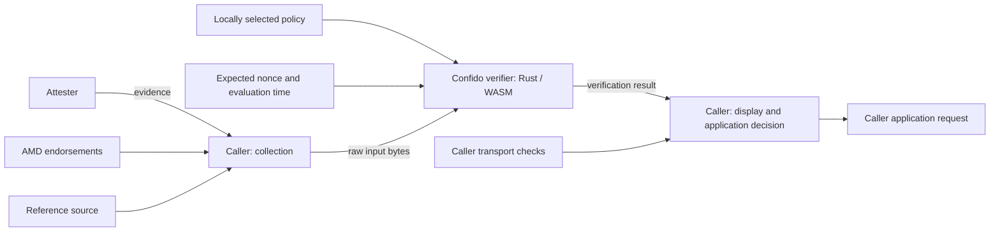

# Confido 0.4: библиотека проверки evidence

Дата: 2026-09-23. Статус: проект обновления; реализация и развёртывание ещё не выполнены.

## 1. Решение и область обновления

`confido` становится библиотекой детерминированной локальной проверки evidence и его соответствия явно переданной verifier policy. Библиотека получает все необходимые данные через аргументы и возвращает структурированный результат. Она не создаёт HTTP/TLS-клиенты, не управляет соединениями и не выдаёт разрешение на прикладной запрос.

Проверка криптографической цепочки и сравнение с доверенным reference остаются в библиотеке. Получение evidence, endorsements и references, создание nonce, выбор policy, получение времени, управление сроком действия challenge, хранение результатов и принятие прикладного решения принадлежат вызывающему приложению.

Один Rust verifier используется в Rust CLI, Python binding и WASM binding. В браузерном расширении весь клиентский код проверки работает локально, из поставляемого пакета расширения. Вызовы удалённого attester, AMD KDS и reference source доставляют входные данные; удалённый verifier и локальный native host не требуются.

Это решение заменяет требования к транспортному API из `docs/revision/decisions/002-api-and-references.md` для новой версии. Документы и результаты 0.3 сохраняются как описание предыдущей реализации. Ранее обсуждавшийся дополнительный зашифрованный прикладной протокол не является необходимой частью этого обновления.

### Проверенная исходная база

| Репозиторий | HEAD на момент проектирования | Область |
|---|---|---|
| `/mnt/confido` | `28471a04c4af23a4765c4584757685ba56245664` | verifier, collector, CLI, bindings, schemas, acceptance |
| `/mnt/confidential-ai-example` | `958a1c0f38df318f378a5c32696ac624381c9df9` | Python relying party, chat, HTTP transport, container |
| `/mnt/ga4gh_service_info_sidecar_gsoc_2026` | `f3db79d2b2881fee2f5e1d9f04c1770d049273fe` | discovery и описание evidence endpoint |
| `/mnt/flint` | `cfce29793343f9926a2f9d272d558d2a30bb84ca` | gateway, Nginx, HTTPS deployment |

До создания этого документа в Confido уже изменён `server/run.sh`; это отдельная пользовательская работа. Остальные три основных дерева были чистыми. Локальный `/mnt/azure-cvm-tooling` содержит посторонние untracked-файлы; зависимость Confido сейчас закреплена Git revision и не использует этот checkout как path dependency.

`genxnetwork/confido-trusted-repository` — внешний источник reference values, локального checkout в рабочей области нет. Смена роли verifier не требует менять уже закреплённые reference bytes или их digest. В просмотренном `/mnt/devops` не обнаружены интеграции этих компонентов; обязательных изменений там не выявлено.

## 2. Границы ответственности

| Обязанность | Владелец после обновления |
|---|---|
| Чтение TPM/vTPM и IMA, получение SNP/HCL, согласованный snapshot | Confido server, native collector |
| `GET /service-info`, `POST /tee-report`, KDS/reference HTTP, retries, cache | CLI / Python-приложение / расширение |
| Генерация непредсказуемого 32-byte nonce, deadline, одноразовое использование | Вызывающее приложение |
| Выбор origin, service identity, reference locator, credentials | Вызывающее приложение |
| Разбор evidence, проверка подписей, цепочки AMD, quote/PCR/IMA, verifier policy | `confido` verifier |
| Проверка DER-сертификата как объекта, включённого в quote | `confido` verifier |
| Сравнение сертификата реального соединения с verified artifact, TLS handshake | Транспорт вызывающего приложения |
| Проверка discovery и повторно полученного service identity | Вызывающее приложение |
| Решение отправлять prompt/credentials и выполнение запроса | Relying party |
| Архив, журналы, измерение времени выполнения, UI | Вызывающее приложение / тонкие wrappers |



Зависимость направлена от collector/client/bindings к общим форматам и verifier. Verifier не импортирует collector, transport или browser APIs. Разделение Verifier и Relying Party соответствует терминологии [RATS, RFC 9334](https://www.rfc-editor.org/rfc/rfc9334.html#section-4.1). Возвращаемый объект остаётся локальным неподписанным результатом функции, а не transferable attestation token.

## 3. Предлагаемый API

### Rust

Ниже эскиз контрактов, а не готовый код. Стабильный entry point один: `verify`.

```rust
pub struct VerificationInput<'a> {
    pub report_json: &'a [u8],       // exact POST /tee-report response bytes
    pub amd_chain_pem: &'a [u8],     // ASK + ARK, in defined order
    pub vcek_der: &'a [u8],
    pub reference_json: &'a [u8],    // exact bytes, not reserialized JSON
}

pub struct VerificationContext {
    pub expected_nonce: [u8; 32],    // supplied independently by caller
    pub evaluation_unix_seconds: i64,
}

pub fn verify(
    input: VerificationInput<'_>,
    verifier_policy_json: &[u8],
    context: &VerificationContext,
) -> Result<VerificationResult, VerificationError>;
```

`VerificationError` обозначает ошибку вызова/конфигурации: невалидную policy, некорректный context, превышение внешнего лимита входа. `VerificationResult.status` описывает завершённую оценку: `verified`, `invalid_evidence`, `policy_mismatch`, `unsupported_profile`, `incomplete_input`. Невалидный report, подпись или сертификат из evidence дают `invalid_evidence`; отсутствие обязательного endorsement даёт `incomplete_input` со списком недостающих частей. Сетевые ошибки остаются в `CollectionResult` приложения. Internal error, WASM trap и исчерпание бюджета никогда не превращаются в успешную проверку.

Для выбора VCEK нужен отдельный чистый helper `inspect_requirements(report_json)`. Он возвращает структурированные **непроверенные** selectors (`profile`, product hint, chip ID, TCB), не произвольный URL и не verified claims. Caller проверяет их форму/лимиты и строит запрос только к разрешённому KDS origin. По полученным endorsements `verify` заново разбирает исходный report и выполняет полную проверку. Endpoint из недоверенного report не управляет сетевым назначением.

### Policy и context

Новая `VerifierPolicy` содержит `schema_version: 2`, поддерживаемый evidence profile, pinned AMD ARK digest, platform policy и reference identity/digest. `reference` сохраняет существующие repository/commit/path/SHA-256, чтобы не менять enrollment и provenance. URL construction и загрузка reference принадлежат caller; в будущем другой provider вводится явной версией схемы.

Текущий `AppraisalConfig` разделяется:

- `VerifierPolicy`: `profile`, `platform`, `reference`, версия схемы;
- `ApplicationPolicy`: `origin`, `service_id`, ожидаемые поля ServiceInfo, требования к транспорту, ссылка на локальную verifier policy;
- `VerificationContext`: ожидаемый nonce и время оценки.

Origin и service ID в ServiceInfo не становятся криптографически подтверждёнными claims только потому, что caller передал их рядом с evidence. Verifier не требует ServiceInfo и может проверить загруженный файл без discovery.

### Значение результата

`VerificationResult`, schema version 2, содержит:

- `scope: "evidence_only"`, `status`, стабильный `reason`, упорядоченные `checks`;
- `profile`, `wire_version`, `evaluated_at` — время, переданное caller;
- `expected_nonce_base64` как echo caller context; caller сверяет его, policy/input fingerprints и собственный request ID перед использованием результата concurrent Worker task;
- `report_sha256` от точных bytes `report_json`, `policy_sha256` от точных bytes policy;
- fingerprints всех supplied endorsements и точного reference; digest не означает успешной проверки их содержания;
- `reference` с immutable identity и digest;
- `verified_claims`: только claims, уже прошедшие соответствующие стадии; для каждого указан stage/provenance;
- `bindings`: результат проверки expected nonce, включённого сертификата и IMA-log transcript;
- `coverage`, `limitations`.

После успешной проверки всей цепочки в `verified_artifacts` доступны DER включённого сертификата, его SHA-256 и SHA-256 SPKI attestation key. Fingerprints, вычисленные до проверки подписи, хранятся как observed input metadata, отдельно от verified artifacts. Binding wrappers представляют DER как bytes/`Uint8Array`; JSON archive — как standard base64.

Из verifier result удаляются `application_admitted`, `mode: live`, `fresh_quote`, `https_peer`, `origin`, `service_id`, `timings_ms`, а также любые client/session handles. Измерение длительности и режим live/replay находятся в caller run record.

`challenge_matches: true` означает, что подпись quote соответствует challenge, переданному caller. Свежесть определяется тем, когда caller создал этот nonce, как долго его ждал и использовался ли он раньше. Verifier не выводит её из `collected_at` или timestamp внутри bundle. Он также не утверждает, что SNP report был пересоздан при получении quote.

`certificate_bound: true` означает включение DER в подтверждённый transcript. Этот результат сам по себе не доказывает соответствие сертификату HTTP-соединения, владение его private key удалённым peer или привязку к TLS session. Проверка current hostname/peer и срока действия peer certificate остаётся в transport policy приложения. Требования evidence profile к форме включённого leaf certificate сохраняются.

Пределы текущего профиля сохраняются: enrolled boot aggregate и kernel modules не подтверждают application/model/GPU state, external inference, непрерывное состояние VM или отсутствие известных уязвимостей. Автоматическая проверка AMD revocation/security advisories остаётся неподдерживаемой и указывается в limitations.

Частично проверенные данные при `policy_mismatch` полезны для диагностики, но общий статус не становится `verified`. Самостоятельно загруженный JSON с `status: verified` не принимается ни одним caller как результат новой проверки.

### Python и WASM

Python distribution предлагается переименовать в `confido-verifier`, import — `confido_verifier`, чтобы новый пакет не делил Python namespace со старым `confido-atls`. Имена требуют проверки доступности перед публикацией; эта работа не включает публикацию.

```python
result = confido_verifier.verify(
    report=report_bytes,
    amd_chain=chain_bytes,
    vcek=vcek_bytes,
    reference=reference_bytes,
    policy=policy_bytes,
    expected_nonce=nonce_bytes,
    evaluation_time=evaluation_time,
)
```

WASM package: рабочее имя `@confido/verifier`, метод `verify` с эквивалентными параметрами `Uint8Array`. Core синхронный; UI вызывает его в Worker и получает Promise из своего orchestration layer. HTTP, `fetch`, cache, `crypto.getRandomValues`, clocks и storage не импортируются WASM-binding.

JSON evidence передаётся в WASM как bytes. Разбор и воспроизведение binding transcript остаются в Rust: преобразование report через JavaScript `Number`/`JSON.stringify` может потерять `u64` и изменить сериализацию. В новых JSON outputs значения вне безопасного диапазона JS представлены decimal strings или hex согласно схеме; bytes — base64. Проверяется допустимый диапазон evaluation time при переходе через JS boundary.

## 4. Изменения в Confido

### Структура

```text
confido/
  Cargo.toml, Cargo.lock         # workspace; отдельные package build gates
  protocol/                     # confido-protocol: wire v1 structs and transcript
  lib/                          # confido: portable evidence verifier
    src/{verify,policy,result,reference,crypto,profile}/...
    src/formats/{snp,hcl,tpm,ima}.rs
  bindings/python/              # PyO3 wrapper; confido_verifier
  bindings/wasm/                # wasm-bindgen wrapper and package generation
  server/                       # native collector + evidence HTTP API
  client/                       # CLI: collect/verify/replay; owns its HTTP I/O
  extension/                    # browser caller/UI; packaged WASM
  schemas/                      # verifier policy/result + caller archive schemas
```

Workspace не означает одинаковые dependency requirements у всех packages. CI отдельно собирает `confido`, Python binding и WASM без TPM/OpenSSL development packages. Server собирается в native job. При введении workspace пересмотреть все пути к `target/`, wheel и binary; сохранить текущие `server/target`/`client/target` до атомарной миграции scripts либо задать их явно через `--target-dir`. Обновить и уже изменённый `server/run.sh`, сохранив согласованную логику перезапуска.

### Перенос существующего кода

| Сейчас | Изменение |
|---|---|
| `lib/src/appraisal.rs::appraise/appraise_inner` | Основа `lib/src/verify.rs`; убрать discovery, origin, clocks, output I/O и application decision; использовать caller expected nonce |
| `appraisal.rs::discover/collect/public_client/limited_body` | Перенести orchestration и HTTP limits в `client/src/collection/`; Python и extension реализуют свои adapters по общему контракту |
| `appraisal.rs::AttestedCertificateVerifier/appraised_tls_config/AppraisedClient/connect` | Вывести из библиотеки; сохранить транспортную реализацию в native adapter приложения `confidential-ai-example` |
| `appraisal.rs::save_private_json`, `run_log.rs` | Caller run-record/logging code; библиотека возвращает структурированные checks |
| `evidence.rs::verify` | Удалить старый async path: он скрыто загружает KDS/reference; новый public `verify` использует supplied bytes |
| `evidence.rs::parse_report`, `verify_measurements` | Перенести чистые части в bounded format parsers и verification stages |
| `evidence.rs::verify_quote_snapshot` | Native collector composition поверх общих чистых quote/transcript helpers; явно не полный verifier |
| `vtpm.rs::get_quote/get_report` и TPM Context | `server/src/collector/`; TPM device access только здесь |
| `vtpm.rs::Quote/PcrBank/Algorithm`, wire structs из `atls.rs` | `protocol/`; никаких TPM/OpenSSL типов в публичном wire model |
| `quote.rs`, `Quote::verify/nonce` | Чистая проверка подписи и bounded TPM decoding без `tss-esapi` |
| `nonce.rs` | Protocol хранит 32-byte challenge и binding v1; генерация nonce — caller; сертификат приходит как DER bytes |
| `kds.rs`, `kds_tests.rs` | CLI collection adapter и его HTTP tests; Python/browser adapters используют те же fixtures/limits |
| `trs.rs::TRS` и measurement comparison | `lib/src/reference.rs`; exact-byte reference digest до доверенного разбора |
| `trs.rs::TRS::get`, DNS/IP/ipify/token-file logic | Исключить из нового API; только явно настроенные reference sources у caller |
| `atls.rs::ATLS/aTLS_connect*` | Исключить из 0.4 library; wire types предварительно вынести в `protocol/` |
| `pylib.rs` | Тонкий wrapper в `bindings/python`, без Tokio runtime, session, network и файлов |
| неиспользуемый `wasm.rs` | Заменить настоящим binding к `verify`; старый `WasmATLS` убрать |

Релиз 0.3 остаётся самостоятельной исторической версией. Совместимые имена `connect_py`, `aTLS_connect_py`, `ATLS`, `AttestedSession` не маскируют смену поведения: в 0.4 их нет. Это явно несовместимое изменение API, требующее одновременной миграции consumers.

### Портируемая криптография и разбор форматов

Сейчас `openssl`, `tss-esapi`, `az-snp-vtpm` с native verifier/default attester features и сетевые зависимости препятствуют простой WASM-сборке. `cfg(target_arch)` вокруг одного `connect` недостаточно. Отдельно убрать native зависимости из полного transitive graph `confido` и обеих bindings.

Предпочтительный конечный backend — одна реализация на Rust для native и WASM. Подписи и hashes берутся из поддерживаемых криптографических библиотек; собственные криптографические примитивы не пишутся. Конкретные версии библиотек для X.509 path validation и алгоритмов закрепляются после короткого dependency/compatibility spike на реальной цепочке AMD.

Обязательная parity matrix до выбора backend:

- pinned ARK digest; ARK/ASK/VCEK подписи, certificate validity относительно supplied time;
- все X.509 path checks, которые сейчас обеспечивает `X509StoreContext`: ограничения CA/path, key usage, поддерживаемые critical extensions и signature parameters; фиксированная topology ARK → ASK → VCEK;
- используемые реальной цепочкой RSA/ECDSA/PSS варианты и параметры; неподдерживаемые алгоритмы явно отклоняются;
- VCEK product/chip ID/TCB/SPL DER checks, в том числе canonical integer encodings;
- SNP versions 2/3, ECDSA P-384/SHA-384, нужные signed bytes и byte order, committed/reported TCB;
- HCL bounds/hash/AK extraction, RSA SHA-256 quote signature, TPM magic/type, nonce, PCR-bank/selection/digest checks;
- boot aggregate, exact IMA order/content, оба текущих пути PCR 10: enrolled SHA-256 и template digest replay.

`x509-parser` можно использовать для разбора; он не заменяет полноценную цепочку policy checks одним успешным parse. Это различие следует из [документации библиотеки](https://docs.rs/x509-parser/latest/x509_parser/). OpenSSL 0.3 используется как сравнительный oracle в tests, с дополнительными независимыми vectors; его поведение не считается автоматически правильным на всех malformed inputs.

Upstream Azure parsing код можно выделить/адаптировать из закреплённой MIT-версии с сохранением notices. Бounded decoding обязано возвращать ошибки вместо текущего `catch_unwind`: WASM traps не служат нормальным механизмом проверки данных. Изменение внешнего upstream не является зависимостью релиза; при выделении полезного standalone decoder возможен отдельный upstream PR.

Лимиты проверяются перед дорогой криптографией: 4 MiB report/reference, 64 KiB HCL/endorsement components по текущему профилю, 16 MiB суммарных входных данных плюс явно ограниченные policy/context. Также задать лимиты PEM certificate count, RSA key size, IMA entries/строк, JSON depth, PCR banks/selection. Новые потолки утвердить по текущим fixtures и adversarial tests; неизвестные схемы и превышения не приводят к частичной успешной проверке. Target и ограничения стандартной библиотеки описаны в [Rust WASM target documentation](https://doc.rust-lang.org/rustc/platform-support/wasm32-unknown-unknown.html).

### Server и wire contract

Server сохраняет `POST /tee-report`, 32-byte base64 nonce, `Cache-Control: no-store`, `profile: azure-snp-vtpm-ima/1`, `wireVersion: 1`, поля `evidence`/`certificate` и текущие TPM concurrency/snapshot/deadline guards. Нативные TPM/OpenSSL dependencies остаются допустимыми у server.

Binding transcript v1 сохраняется byte-for-byte:

```text
SHA256(nonce[32] || certificate_DER || SHA256(serde_JSON(IMA_entries)))
```

Существующий `lib/tests/fixtures/binding-v1.json` становится общим protocol vector. Включённый certificate продолжает быть частью evidence; сам факт его присутствия не возвращает управление соединением в verifier. Удаление certificate из wire или введение другого binding — отдельная версия протокола, не побочный эффект рефакторинга.

Server продолжает проверять согласованность quote snapshot перед выдачей evidence и соответствие provisioned certificate/private key при запуске. Новый HTTP endpoint, server-side admission token и encrypted tunnel для перехода к verifier не нужны.

### CLI, packaging, schemas, CI

CLI остаётся приложением с правом выполнять network/file I/O. Команды сделать явными: `collect APP_POLICY ARCHIVE`, `verify INPUT POLICY --expected-nonce ... --at ...`, `replay ARCHIVE POLICY --at ...`; convenience-команда `appraise` может собирать и проверять evidence, но не создаёт application session. Exit status `0` означает только `verified` evidence, `2` — отрицательный verifier result, `1` — collection/configuration/runtime error.

`inspect_requirements` помогает CLI получить VCEK. KDS adapters сохраняют body limits, максимум три попытки и 60-second общий budget; cache содержит bytes, и certificate validity повторно проверяется для каждого evaluation time.

Добавить `verifier-policy-v2.json`, `verification-result-v2.json`, `verification-archive-v2.json` и schemas для input/context. Старый `appraisal-result-v1.json` остаётся для старых артефактов. В archive отдельно лежат raw inputs, originally supplied context, collection metadata, verifier result и необязательный caller decision/transport record. Replay воспроизводит локальную проверку при явно выбранном времени, не исполняет сохранённое решение приложения.

Преобразование старого `EvidenceBundle` выполняется явным adapter: raw reference bytes сохраняются; если original report bytes не были сохранены, записывается `legacy_reserialized_report`, и новый digest не выдаётся за исходный wire digest. Старый nonce разрешено использовать из архива только в обозначенном historical replay. Live caller всегда передаёт собственный новый nonce; verifier никогда не берёт expected nonce из входящего bundle.

Обновить `lib/Makefile`, `lib/pyproject.toml`, все Cargo manifests/locks, RPM specs, `.github/workflows/{test,release,publish-pypi}.yml`, README. Целевая breaking version — 0.4.0; номер пакета, schema version и wire version изменяются независимо. Отдельные jobs: native verifier, installed Python wheel, WASM, server/collector, cross-repository acceptance. Публичная публикация не входит в реализацию рефакторинга.

## 5. Confidential AI Example

Приложение становится владельцем complete flow:

```text
application policy → discovery → consent → nonce + collection
→ confido_verifier.verify → transport peer validation + metadata confirmation
→ application admission → credentials → chat request
```

| Файлы | Изменение |
|---|---|
| `confai-promter.py::setup_client` | Вызывать local orchestrator вместо `discover_py/connect_py`; разделить вывод evidence result и application decision |
| новый `demo/collection.py` | HTTPX bootstrap/evidence/KDS/reference retrieval с лимитами, allowlists, token scoping и cache |
| новый `demo/policy.py` | Загрузка `ApplicationPolicy` и локально выбранной `VerifierPolicy` |
| новый `demo/admission.py` | Nonce lifecycle, exact input/result association, consent, decision; replay/error не разрешают chat |
| новый `demo/transport.py` | Origin-scoped HTTPX adapter приложения |
| новый `native_transport/` | Перенос существующего Rust/rustls peer verifier и scoped client из Confido; отдельный PyO3 module `_confai_transport` |
| `profiles/{match,mismatch}.json` | Application profiles с явной ссылкой на verifier policy; сохранить текущие разные pinned references |
| `tests/test_admission.py` | Проверять поведение caller, а не наличие `Confido.AttestedSession` |
| `Makefile`, `Dockerfile`, `requirements.*` | Новый verifier wheel и app-owned transport wheel, hashes/locks/version checks |
| `scripts/{build_manifest,dev_info,container_acceptance}.py` | Проверять оба компонента, schema versions и фактические artefact hashes |
| README, `example-output.md` | Объяснить отдельно результат evidence и решение приложения |

Native adapter принимает immutable peer policy (`origin`, expected certificate DER), проверяет exact DER/hostname/validity в TLS handshake каждого соединения и сохраняет запреты redirect/downgrade/cross-origin. Он не импортирует verifier, не выбирает reference и не объявляет evidence verified. Транспорт создаёт приложение только после успешного `verify`, заново проверяет metadata и затем открывает credential gate. Это перенос существующей реализации с её tests, чтобы смена API не ослабила текущий native demo.

Transport package принадлежит этому приложению и не входит в WASM/extension dependencies. Вся extension verification работает без него. Новый пакет не должен оказаться обязательной или скрытой optional-зависимостью `confido-verifier`.

Текущий native bootstrap к self-signed demo может временно сохранять явный unauthenticated collection mode без credentials; доверие metadata появляется только после app-owned peer check. Browser path использует обычный HTTPS, принимаемый браузером. В обоих случаях root/platform/reference policy выбираются локально и не заменяются содержимым discovery.

Client сохраняет один публичный input/output flow, но записывает два разных объекта: `VerificationResult` и `ApplicationDecision`. Поле `application_admitted` допустимо во втором объекте как решение caller; оно не появляется в verifier schema.

## 6. GA4GH Service Info Sidecar

| Файлы | Изменение |
|---|---|
| `internal/handler/service_info.go` | Сохранить корректную wire v1 advertisement; использовать общую fixture для контрактной проверки |
| `internal/handler/service_info_tee_test.go` | Проверять, что metadata объявляет наличие evidence endpoint, а не успешную аттестацию/допуск |
| `docs/tee-report-extension.yaml` | Уточнить смысл certificate binding и разделение verifier result / application policy; wire enums остаются v1 |
| `docs/{attestation,api,configuration}.md`, README | Новый flow: caller retrieves → verifier checks → caller decides |
| `configs/{match-demo,mismatch-demo}.yaml` | Обновить только изменившиеся display/version metadata; service IDs сохранить |
| `deploy/systemd/*`, Helm/configmap examples | Проверить согласованность endpoint и версии deployment; новые сети/порты не требуются |

`sessionBinding.supported` остаётся `false`. Отдельного флага `verified: true` в ServiceInfo не возникает. Sidecar не вызывает verifier, не выдаёт доверенную policy и не собирает evidence от имени extension.

Исправить уже устаревшее описание выбора negative reference через IP/DNS в `docs/attestation.md`: действующая схема выбирает immutable reference из локальной policy. Match/mismatch проходят один verifier code path.

## 7. Flint и публичный HTTPS

Flint продолжает обслуживать application API. Verifier не включается в LiteLLM и не становится gateway middleware.

| Файлы | Изменение |
|---|---|
| `nginx/flint.conf` | Сохранить `/service-info`, `/tee-report`, `/v1/...`; проверить deployment с browser-trusted certificate |
| `nginx/configure.sh` | Проверять provisioned certificate paths/hostname/key consistency без вывода secrets |
| `nginx/confido-8000.conf` | Исправить stale comment: evidence приходит с `/tee-report`, ServiceInfo содержит advertisement |
| `compose.yaml`, `flint.service` | Рефакторинг verifier не требует менять gateway image, порты или добавлять verifier service; продолжить проверку loopback exposure |
| README | Описать transport ownership приложения, browser requirements и существующую внешнюю inference boundary |

Для live проверки из расширения публичный HTTPS endpoint должен приниматься браузером без ручного обхода certificate errors. План deployment: provision browser-trusted сертификат с нужными SAN и согласованно использовать его в Nginx и collector v1. При обновлении сертификата collector обязан выдавать новый DER в evidence; rotation/reload обоих компонентов проверяется staging test. Изменение сертификата само по себе не требует менять IMA reference или platform enrollment.

Bootstrap остаётся доступным без application credentials; `/v1` сохраняет текущую аутентификацию. Browser-specific permissions/CORS проверяются для фонового контекста расширения, не для запросов из content script. Wildcard credentialed CORS не используется. KDS/reference endpoints остаются отдельными разрешёнными origins; если браузерная доставка окажется недоступна, допустим cache/proxy **сырых подписанных endorsements** с обязательной локальной проверкой, но такой proxy добавляется только по результатам конкретного integration test.

Изменение canonical Nginx template в Flint сопровождается обновлением зеркал `confido/server/{conf/nginx.conf,deployment/nginx-confido.conf}` и preflight equality check. Production certificate provisioning и переключение live services — отдельный deployment шаг после review/test реализации.

## 8. Browser extension

Разместить первый extension consumer в `confido/extension/`. Это позволяет проверять его вместе с WASM package без создания обязательного пятого репозитория. Сборки используют общий JS/TS code и browser-specific manifest/build adapters для Chromium, Firefox и Safari.

Предлагаемые модули: `collection`, `policy-store`, `challenge-store`, `verification-worker`, `run-record`, `ui`. Content script, если понадобится, передаёт только пользовательскую команду фоновому контексту; web page не выбирает trust anchors, reference или accepted result.

Последовательность:

1. Пользователь выбирает установленную/импортированную verifier policy и разрешённый HTTPS endpoint.
2. Background context проверяет discovery согласно application configuration и создаёт nonce через browser CSPRNG.
3. Получает report, endorsements и exact reference bytes с limit/deadline/redirect guards, без application cookies/credentials. Session с challenge существует только в памяти и имеет deadline.
4. Worker вызывает WASM `verify` с исходными bytes, независимым expected nonce и временем caller.
5. UI показывает status, stages, matched reference, fingerprints и фактическую coverage. Отдельно показывает источник evidence и уровень transport observation; origin не представляется attested claim.
6. Пользователь может сохранить verification archive. При restart/suspension потерянный pending challenge не восстанавливается как действующий, сохранённый result показывается как история.

Первая extension feature — evidence verification. Она не отправляет chat prompts, не перехватывает произвольный трафик вкладки и не обещает защиту будущих запросов. Если позже extension станет relying-party client, его собственный admission/transport module получает отдельные требования; успех verifier не создаёт эту гарантию автоматически.

WASM и JS поставляются внутри extension. Для Chromium добавить необходимый `wasm-unsafe-eval` CSP согласно [официальной документации](https://developer.chrome.com/docs/extensions/reference/manifest/content-security-policy). Целевые минимальные версии назначаются по реальным тестам каждого browser engine; portable WASM сам по себе не подтверждает поддержку всех версий браузеров.

Для Safari нужен отдельный packaging/testing path. [Apple описывает Safari Web Extension packaging](https://developer.apple.com/documentation/SafariServices/safari-web-extensions) через app extension; verifier при этом остаётся внутри Web Extension JS/WASM, исполняемый native verifier не добавляется. Safari acceptance выполняется в настоящем Safari на macOS, а не объявляется на основании WebKit automation в другом окружении.

TLS certificate inspection APIs можно позже использовать для дополнительной информации. Они не нужны базовому evidence verifier и не являются общей обязательной зависимостью всех браузеров.

## 9. Порядок реализации и миграции

| Изменение | Репозитории | Завершение шага |
|---|---|---|
| 1. Зафиксировать v2 input/policy/result/archive schemas и общие vectors | Confido | Явные nonce/time semantics; old bundle adapter cases; API migration examples |
| 2. Выделить protocol и pure verifier, убрать скрытое I/O | Confido | Verifier callable без network/TPM/files; separate collector and CLI packages |
| 3. Подобрать portable crypto/backend, перенести bounded codecs | Confido | Полная parity matrix на native/WASM; pinned dependencies; malformed corpus без traps |
| 4. Выпустить локальные Python/WASM artifacts 0.4 | Confido | Installed-wheel и WASM tests на общем corpus; no native dependencies in verifier graph |
| 5. Перенести orchestration, transport и admission в demo | Confidential AI Example + Confido acceptance scripts | Native match/mismatch сохраняют реальные request/credential gates |
| 6. Согласовать discovery/docs и browser HTTPS deployment templates | Sidecar + Flint + Confido mirrors | Schema validation, same wire v1, synchronized Nginx, staging certificate rotation |
| 7. Реализовать extension consumer и browser adapters | Confido extension + staging fixtures | Real-browser file/live verification; no native host; common verifier results |
| 8. Полный rerun, manifest и migration docs | Все четыре | Отдельные результаты verifier/collection/transport/admission и hashes artifacts |

Шаги 2–3 могут проходить промежуточными внутренними коммитами с native backend; 0.4 не считается готовой до единой portable реализации и parity gates. Старые installed wheels/containers продолжают использовать 0.3 до согласованного обновления consumers. Новый verifier не вводится под старым именем transport API.

При rollout wire v1 позволяет обновлять collector/sidecar независимо от client packages, если их текущие contract tests проходят. Сначала local artifacts и staging, затем app/extension packaging; promotion выполняется по конкретным проверенным artifacts. Rollback возвращает согласованный набор старого app + его library/transport dependencies, а не смешивает API двух версий.

## 10. Проверки готовности

| Проверка | Доказательство |
|---|---|
| Чистый verifier | Native execution без network/device access; target-specific dependency/import audit; только supplied time/nonce; отсутствуют скрытые logger/file side effects |
| Детерминизм | Одинаковые bytes/policy/context дают одинаковый result на Rust, установленном Python и browser WASM; durations вне result |
| Challenge isolation | Старый report с новым expected nonce отклоняется; изменение bundle nonce/collected_at не помогает; оба endpoint используют одну процедуру |
| Политика независимо от evidence | Evidence/discovery не могут заменить pinned root/reference; policy/reference mutation tests |
| Crypto parity | Сохранить SNP/HCL/AK/quote/PCR/IMA negative vectors, hardware-derived frozen corpus, X.509 edge cases и независимые signature vectors |
| Input safety | Oversized/nested/truncated evidence, malformed HCL/TPM/DER, duplicate banks/extensions, integer/length overflow не дают panic/trap или unbounded work |
| Result semantics | Schema запрещает admission/session fields; verified artifacts не заполняются непроверенными values; uploaded result нельзя использовать как fresh result |
| Native demo | Decline/mismatch/collection failure/peer mismatch/changed metadata отправляют 0 prompts и 0 credentials; valid case отправляет 1 synthetic request |
| Native reconnect | На каждом новом connection проверяется expected cert до application bytes; другой origin, redirect, downgrade и cert swap отклоняются |
| Browser | Реальные Chromium и Firefox; Safari на macOS: packaged WASM, file verification, permitted live fetch, no credentials, Worker failure/restart/timeout, policy import |
| Protocol | Binding-v1 vector совпадает у collector/native/WASM; sidecar advertisement и GA4GH schema проходят validation |
| Packaging | Verifier wheel не требует TPM2-TSS/OpenSSL; server native prerequisites отдельны; app transport artifact имеет собственный hash |
| Deployment | Loopback backends, browser-valid HTTPS, collector/Nginx certificate consistency, synchronized templates, no new public listener |

Тесты существующего transport не удаляются вместе с `AppraisedClient`: они переезжают к его новому владельцу. `scripts/{preflight,stage_demo,replay_checks,validate_contract}.py` нужно перевести на новые владельцы и schemas; проверки `application_admitted` относятся к app record, replay tests проверяют отсутствие live effects и независимость expected nonce.

Оценку производительности выполнять отдельно от hardware/network time. Прежняя цель p95 local appraisal ≤3 seconds остаётся ориентиром для измерений на названном browser/device, не обещанием. Фиксировать input size, engine/version, sample count и memory; при timeout caller отменяет Worker и получает failure.

Исторические `docs/revision/results.md`, run JSON и coverage не переписываются как будто они относятся к 0.4. Создать новый manifest: SHAs всех четырёх repos, locks, wheel/WASM/extension/container hashes, schema versions и наблюдаемые результаты. Реальные hardware tests и mocked orchestration tests маркируются отдельно.

## 11. Что требует технического подтверждения при реализации

1. Portable X.509 path validation и точный набор signature algorithms реальной AMD chain — главный implementation spike. До parity completion OpenSSL removal не считается завершённым.
2. Browser delivery от KDS/reference, доступные host permissions и Worker lifecycle проверяются на целевых версиях; policy и verifier API от этого не меняются.
3. Размер/производительность WASM и memory budget определяются измерением текущих hardware-derived bundles.
4. Public HTTPS certificate и Safari test machine — требования для соответствующих live acceptance checks. Их отсутствие не блокирует проектирование/portable verifier tests, но не позволяет отметить browser live support как проверенную.

Эти пункты не возвращают сетевое управление в библиотеку. Основной критерий: `verify(bytes, policy, expected_nonce, evaluation_time)` имеет одинаковый смысл во всех средах, а все решения о взаимодействии с сервисом принимает вызывающее приложение.

## 12. Реализация

См. [validation report](evidence-verifier-0.4-validation.md) и
[migration guide](../migration-0.4.md). Реализованные уточнения:

- Сохранены отдельные Cargo packages/locks/target directories; root workspace не
  вводился, чтобы сохранить server launcher и binary paths.
- Portable backend: ring (C компилируется в WASM) и bounded parsers. В verifier
  runtime нет OpenSSL/TPM/network; native test fixtures используют OpenSSL.
- Binding wrappers возвращают JSON-compatible artifact fields с DER base64.
- Extension импортирует policy из файла на каждый запуск; policy/challenge не
  восстанавливаются из сохранённого результата. Отдельное persisted policy store
  для первой версии не требуется.
- Автоматическая проверка разрешений отклонила широкий `https://*/*` access.
  Live origins явно ограничены двумя demo endpoints, AMD KDS и GitHub; локальный
  replay не требует network permissions.
- Safari browser adapter сгенерирован, macOS packaging/acceptance остаётся отдельной
  проверкой среды. Поддержка Safari не объявляется подтверждённой Linux тестами.
